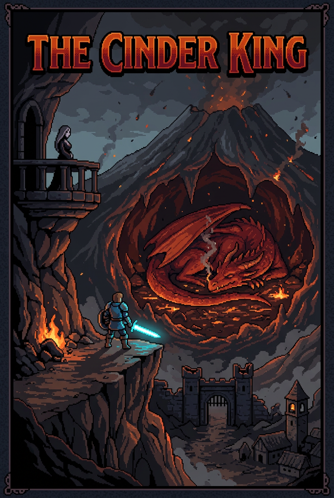

# The Cinder King

> **Every night, a bell tolls beneath the grave of Brindlemere.** Nobody in the village rang it. Nobody alive, anyway.

A Game Boy-style fantasy RPG (Phaser 3, SRD 5.1 monsters and items) that I am building with a hybrid team of AI agents. Every line
of code is written by a model running on a home server in my office. Cloud models play the senior developers: they write the plans
and review each build. I drive the vision, play each build, write what is wrong or missing, and the team turns that into the next
round.

## Why

Frontier models can build this in one go. I wanted to know how much of that work models I run myself can take over: more rounds,
more time and more of my own feedback, and less dependence on a cloud service that may get more expensive or harder to reach.

I started out aiming for 100 % local. The coding works: a local model with a 3B-active-parameter footprint builds this game step
by step. Planning does not, yet: local plans came out far weaker than a frontier model's in blind reviews. So the game is finished
the hybrid way, with all the code local and the planning and reviews in the cloud, and local planning comes back when a bigger card
lets me run larger models.

## How it is made

- **Hardware:** a Mac Pro (2012) with two NVIDIA cards, a Tesla T4 (16 GB) and a Quadro RTX 4000 (8 GB), running llama.cpp.
- **The builder:** Qwen3.6-35B-A3B (3B active parameters, about 80 tokens a second on both cards), driven by the
  Pi coding agent.
- **The senior developers (cloud):** Claude writes each round's plan as small steps, one test per step, and reviews the build
  afterwards. The plan and the tests are the hand-over: the local model never sees the cloud, only the next step and its test.
- **The builder at work:** the local model builds the game one step at a time, each step in a fresh session, and a step only
  counts when its test passes. Fixed checks make sure the earlier parts still work and that the maps are actually drawn.
- **My feedback rounds:** after each build I play it and write notes. They become small fix steps with tests, which the local
  model builds. Repeat until the game is good.
- **Art:** free pixel-art packs (Kenney Tiny Dungeon, DawnLike), chosen in a blind test against AI-generated sprites. A local vision
  model and a Claude review matched each monster and item to its sprite.
- **Story:** "The Cinder King", an original story in three acts and eight chapters: a haunted crypt, a cult that sings to wake a
  dragon, a broken blade to reforge, and a villain who has been waiting three hundred years. The outline is in `story/`.

`PROVENANCE.md` records who made each part, local or cloud, and when, so the claim ("every line of code written by local AI")
can be checked line by line.

## Play

Serve the `game/` folder with any static web server and open `index.html`, for example `python3 -m http.server -d game 8000`.

Controls: arrows move, Z or Space is A, X is B, Enter is Start (menu). The on-screen buttons work on a phone. I'm also planning a
version for an ANBERNIC RG40XXV handheld.

## Progress

The first commit (`v0.3-starting-kit`) is where the local agents start: a small town, a house, battles and a crypt quest from
earlier rounds, plus the data for the full world (36 lands, 52 people, 83 monsters, 87 items). Every later commit is one round of
local work, tagged and recorded in `PROVENANCE.md`.

| Where | What |
|---|---|
| `game/` | the playable game, at its latest round |
| `story/` | the story outline, the back-cover text and the cover art |
| `PROVENANCE.md` | who made each part, local or cloud |
| `CREDITS.md` | the open works the game uses and their licences |

## Licence

Open source. The game's code is under the **MIT licence** (`LICENSE`). The original story, text, world data and cover art are under
**CC BY 4.0** (`LICENSE-CONTENT`). Third-party works keep their own licences, listed in `CREDITS.md`: SRD 5.1 (CC BY 4.0), Phaser
and rexUI (MIT), Press Start 2P (OFL), Kenney Tiny Dungeon (CC0) and DawnLike (CC BY 4.0).
